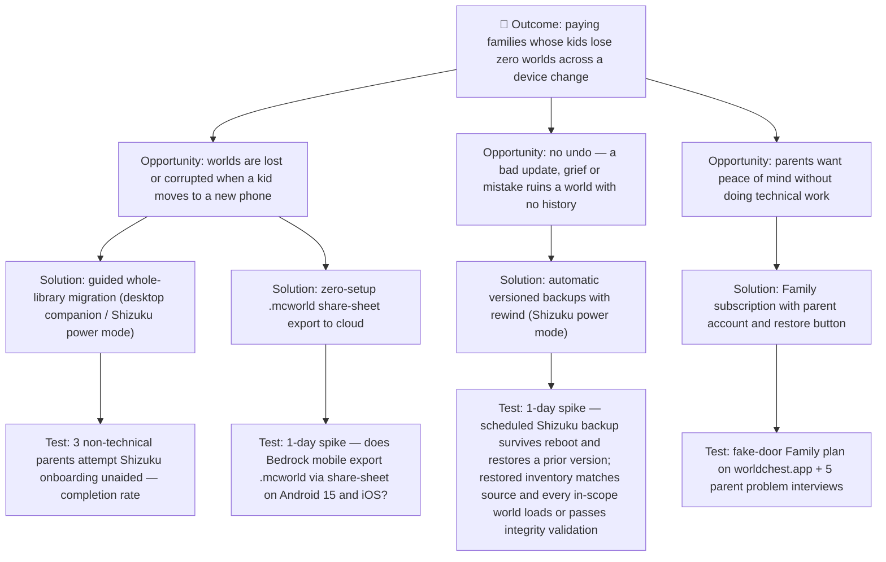

# Opportunity–Solution Tree — WorldChest: backup, sync, restore & versioning for Minecraft Bedrock worlds

- **Slug:** `worldchest`
- **Last updated:** 2026-10-20

## Notes

- **Outcome** is a metric, not a feature: *paying families with zero lost worlds across a
  device change*. The thread names no outcome metric, so this one is inferred from the
  JTBD and the freemium-to-Family model [ASSUMPTION].
- **Opportunities** come from the Discussion's problem statement and JTBD (device
  change, no undo, parent as buyer). Creator/streamer and classroom segments are
  left out of the tree until the primary family segment is validated.
- **Solutions** are the thread's proposed tiered-access model. The official Mojang API
  "holy grail" is left out because it is not something this team can test.
- **Sync is not branched.** The title names sync, but the thread proposes no sync solution
  (conflict behaviour) and no sync test, so the tree has no sync branch. Sync is deferred
  until the backup and restore branches are validated.
- **Assumption tests** match brief §6. A4 (willingness to pay) comes first because it
  kills the business if it fails. A1 comes next because it is the thread's own "biggest
  conversion risk".
- The tree is built from the Discussion only; `brainstorm.md` is reconstructed from the same thread.
